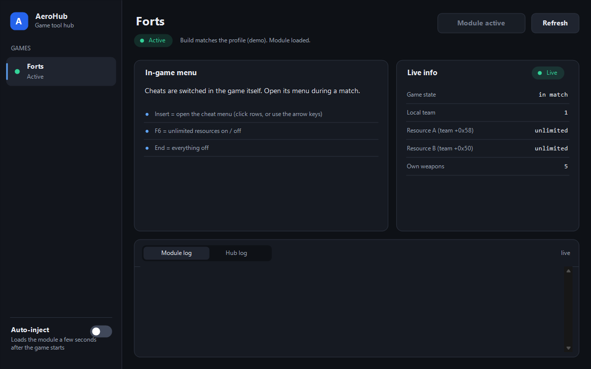
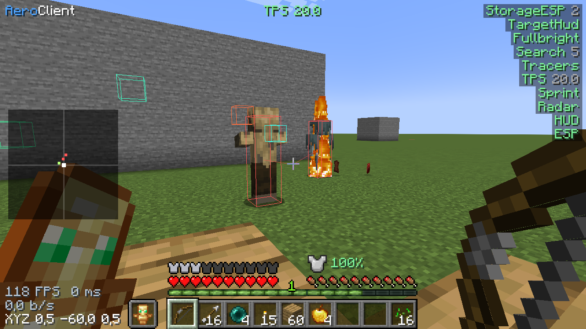
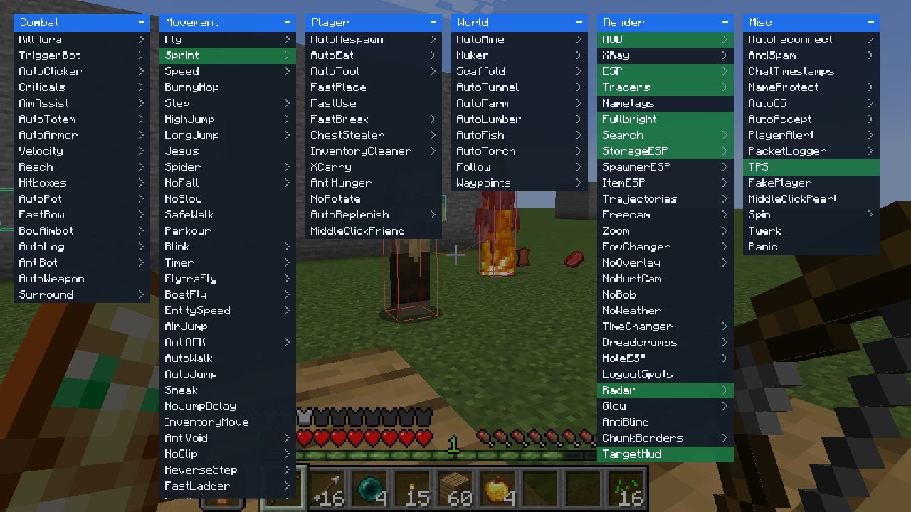
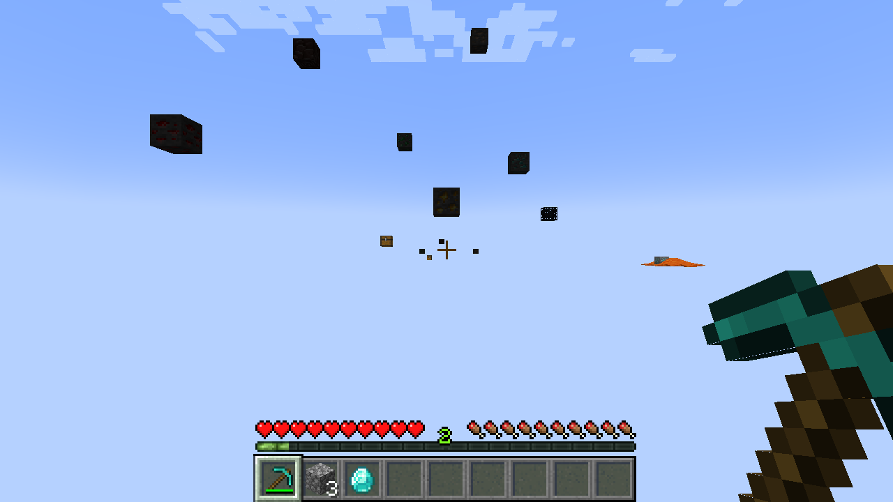
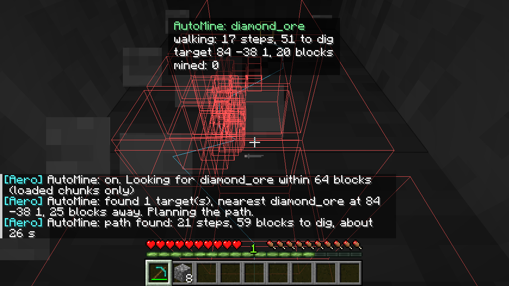
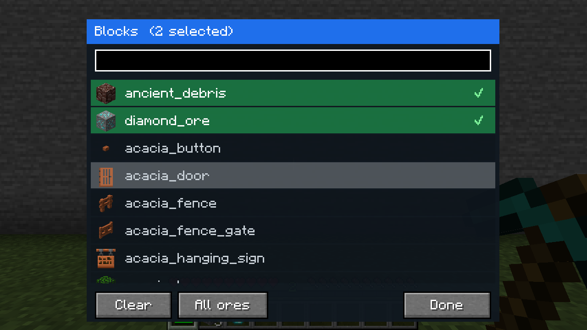
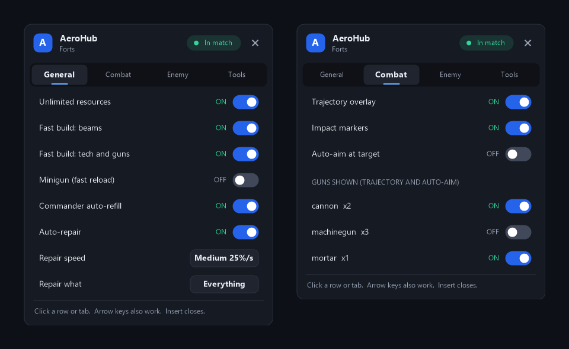
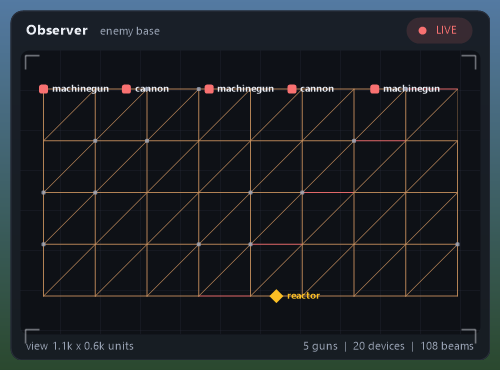

<p align="center">
  
</p>

<p align="center">
  
  
  
</p>

**AeroHub** — единое приложение с читами для разных игр. Хаб показывает список игр, проверяет сборку запущенной игры и загружает её модуль, а функции включаются в меню прямо в игре.

## Игры

| Игра | Статус |
|---|---|
| Forts | ✅ Готово |
| Minecraft Java 1.21.1 | 🟡 Мод для Fabric: 114 модулей и автокопание руды, [подробнее](modules/minecraft/README.md) |

Список будет расти.

<p align="center">
  
</p>
<p align="center"><sub>Окно хаба в режиме <code>--demo</code>, данные тестовые.</sub></p>

## Minecraft

<p align="center">
  
  
</p>
<p align="center">
  
  
  
</p>

**AeroClient** — клиентский мод для Fabric 1.21.1. В игру ничего не внедряется: миксины применяются только при старте игры, поэтому это обычный мод. Вкладка **Minecraft** в хабе делает две вещи: **Auto-detect Minecraft** находит игру (запущенный процесс, Modrinth App, TLauncher, `.minecraft`), а **Install mod** кладёт мод в «Загрузки», откуда ты сам закидываешь его в папку `mods`. Когда игра загрузит мод, хаб показывает мир, позицию, FPS и включённые модули. В нём 114 модулей в шести категориях, меню на Right Shift или Insert, команды с точкой в чате настоящий **X-Ray** (камень исчезает, остаются руды; работает и со Sodium) и **автокопание руды**: фильтр блоков выбирается в меню (правый клик по AutoMine, строка Blocks) или командой `.mine diamond_ore`, мод находит руду рядом, строит самый быстрый путь (с прокопом через камень, где это быстрее обхода), показывает его в мире и на панели и добывает руду. Полный список модулей, правила и установка: [modules/minecraft/README.md](modules/minecraft/README.md).

Мод и связь с хабом проверены запуском в самой игре: тест создаёт мир, гоняет автокопание в шести ситуациях и каждый модуль. Работу на чужих серверах и с шейдерами я не проверял, и серверы сами решают, принять ли действие игрока.

## Forts

Меню открывается клавишей `Insert`. Для сетевых матчей есть мод AeroHub в Steam Workshop.

### Функции

| Вкладка | Функция | Одиночная игра | Онлайн |
|---|---|---|---|
| General | Бесконечные ресурсы | ✅ | ✅ через мод |
| General | Быстрая постройка балок | ✅ | ❌ |
| General | Быстрая постройка техники и пушек | ✅ | ✅ через мод |
| General | Быстрая перезарядка (Minigun) | ✅ | ✅ через мод |
| General | Автозаполнение шкалы командира | ✅ | ✅ через мод |
| General | Авторемонт, настройка скорости и цели | ✅ | ✅ через мод, с обычной скоростью |
| Combat | Траектории с учётом гравитации и сопротивления воздуха | ✅ | ✅ |
| Combat | Маркеры попадания и фильтр по типам пушек | ✅ | ✅ |
| Combat | Автонаведение на выбранную цель | ✅ | ❌ |
| Enemy | Оверлей вражеских устройств | ✅ | ✅ |
| Enemy | Окно наблюдения за базой врага | ✅ | ✅ |
| Enemy | Панель разведки: ресурсы, шкала командира, реактор | ✅ | ✅ |
| Tools | Запись выстрелов и диагностика в лог, «All off» | ✅ | ✅ |

<p align="center">
  
  
</p>
<p align="center"><sub>Меню и окно наблюдения отрисованы кодом проекта вне игры, данные тестовые.</sub></p>

### Быстрый старт

1. Скачай архив из раздела [Releases](../../releases/latest) и распакуй его в любую папку.
2. Переключи Forts на OpenGL: в файле `users/<steamid>/settings_hardware.lua` укажи `EnableVulkan = false`. Под Vulkan модуль не работает.
3. Запусти `AeroHub.exe`. Кнопка **Launch game** откроет игру через Steam.
4. Нажми **Inject module** или включи **Auto-inject**.
5. В матче открой меню клавишей `Insert`.

### Горячие клавиши

| Клавиша | Действие |
|---|---|
| `Insert` | Открыть или закрыть меню |
| `↑` `↓` `←` `→` | Управление меню с клавиатуры |
| `F6` | Включить или выключить бесконечные ресурсы |
| `End` | Выключить всё |

### Онлайн

1. Каждый игрок подписывается на [мод AeroHub](https://steamcommunity.com/sharedfiles/filedetails/?id=3834651515) в Steam Workshop.
2. Мод включается в лобби.
3. Игрок запускает AeroHub и включает нужные функции в меню.

Без приложения мод ничего не делает. Версия мода должна совпадать у всех игроков, иначе игра разойдётся и начнётся десинхрон.

### Совместимость

| Параметр | Значение |
|---|---|
| Игра | Forts, Steam App ID 410900 |
| Сборка | Steam buildid 26181732 |
| Проверка | `TimeDateStamp 0x6ADC9FAD`, `SizeOfImage 0x9D3000` |
| Система | Windows x64 |

Хаб сверяет сборку перед загрузкой модуля и откажется работать с другой версией игры. После обновления Forts адреса нужно измерить заново. Все значения, зависящие от сборки, лежат в [`modules/forts/FortsConfig.hpp`](modules/forts/FortsConfig.hpp).

### Ограничения

- Модуль не видит, загружен ли мод в лобби, поэтому онлайн переключатель может быть включён, хотя мода нет.
- Онлайн ремонт идёт по обычным правилам игры: он стоит ресурсы и занимает обычное время.
- Быстрая постройка балок и автонаведение в сетевых матчах отключены.
- Бинарники не подписаны, поэтому Windows SmartScreen может показать предупреждение.

## Сборка из исходников

Нужны Visual Studio 2022 или Build Tools с MSVC x64, Windows SDK и CMake 3.20 или новее.

```powershell
cmake -S . -B build -G "Visual Studio 17 2022" -A x64
cmake --build build --config Release
```

Готовая к запуску папка появится в `build/out`.

## Структура проекта

| Папка | Содержимое |
|---|---|
| `core/` | Общая библиотека: чтение PE, поиск процесса, загрузка DLL, хуки IAT, связь с хабом, элементы интерфейса |
| `hub/` | Приложение `AeroHub.exe` |
| `modules/<game>/` | Модуль игры, сейчас `modules/forts/`: функции, меню и оверлей |
| `modules/minecraft/` | Мод AeroClient для Minecraft Java на Fabric (отдельный проект Gradle). В хабе ему соответствует профиль `profiles/minecraft.ini` (`Kind=FabricMod`) |
| `mods/aerohub/` | Мод Forts для сетевых матчей |
| `profiles/` | Профили игр с ожидаемой сборкой и настройками |
| `docs/` | Изображения для этого файла |

Подробная история реверса и замеров Forts находится в [`HANDOFF.md`](HANDOFF.md).

## Как добавить игру

1. Создай профиль `profiles/<game>.ini`: процесс, путь к модулю и ожидаемая сборка.
2. Создай модуль в `modules/<game>/`.
3. Добавь цель модуля в `CMakeLists.txt`.

Хаб сам покажет игру в списке.
