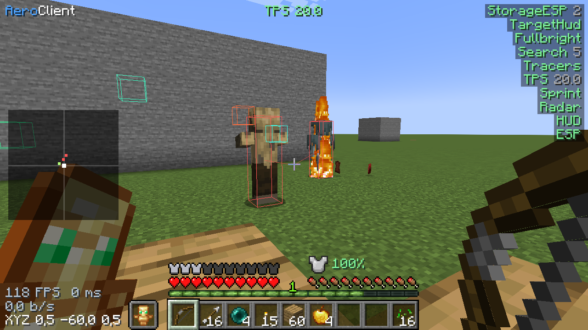
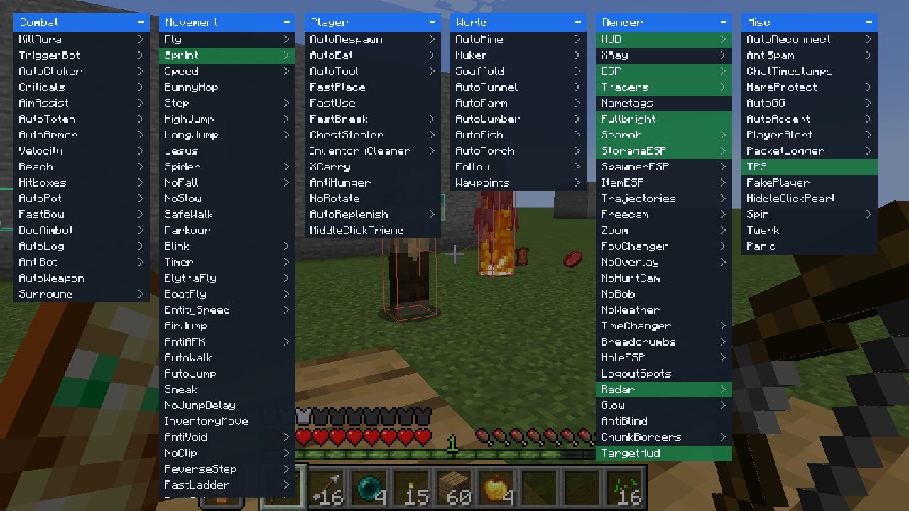
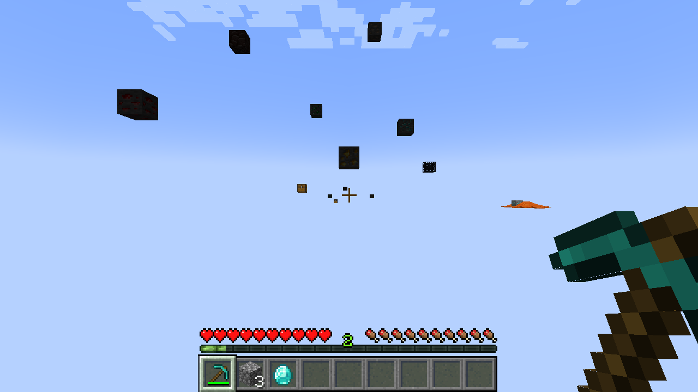
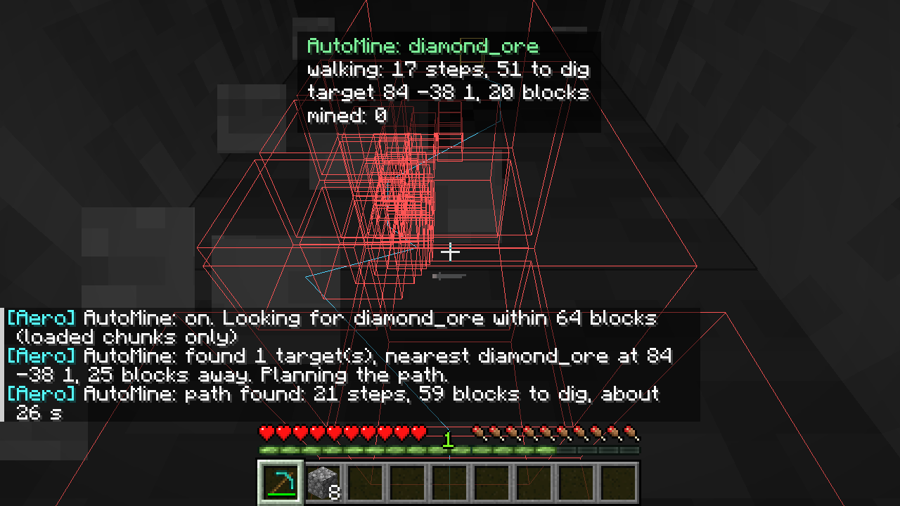
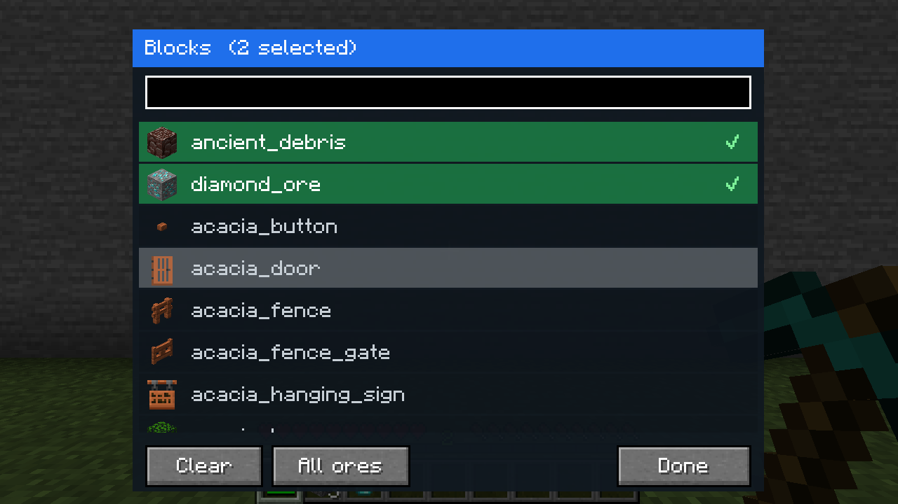

# AeroClient: мод для Minecraft Java 1.21.1

Клиентский мод на Fabric: **114 модулей**, меню на Right Shift или Insert, команды с точкой в чате, настоящий **X-Ray** и автокопание руды с поиском кратчайшего пути. Ставится в папку `mods` профиля, как обычный мод, внедрять ничего не нужно.

<p align="center">
  
  
</p>
<p align="center">
  
  
</p>
<p align="center">
  
</p>
<p align="center"><sub>Снимки сделаны самим тестом в игре: плоский мир, руда за стеной подсвечена, меню на Right Shift.</sub></p>

## Автокопание (AutoMine)

Ты задаёшь фильтр блоков, мод ищет такие блоки рядом, строит путь до ближайшего и копает.

**Где фильтр.** Открой меню (Right Shift или Insert), правой кнопкой мыши раскрой **AutoMine**, нажми строку **Blocks** (справа надпись `edit`). Откроется окно со списком всех блоков игры: иконки, поиск, галочки. Выбранные блоки идут сверху, кнопка **All ores** добавляет все руды, **Clear** очищает список. Тот же редактор открывается у списков XRay, Search и Nuker. Командами то же самое: `.mine diamond_ore`, `.mine add gold_ore`.

**Что видно, пока он работает.** В мире рисуется найденный путь (голубая линия, текущий шаг белый), красными рамками отмечены блоки, которые будут прокопаны, жёлтой рамкой цель. Сверху по центру панель: что ищет, что делает сейчас («walking: 17 steps, 51 to dig»), координаты цели и сколько добыто. В чат приходят сообщения: что найдено и как далеко, сколько шагов и блоков копать и примерно за сколько секунд, что добыто. Всё это отключается настройками `Show path`, `Status panel`, `Chat messages`.

```
.mine diamond_ore            включить автокопание алмазной руды
.mine diamond_ore ancient_debris
.mine ores                   список всех руд игры
.mine add gold_ore           добавить в фильтр
.mine remove gold_ore        убрать из фильтра
.mine list | .mine clear | .mine stop
```

Как это работает:

- **Поиск.** Мод просматривает только прогруженные чанки в радиусе `Range` (по умолчанию 64 блока, до 128) и берёт блоки из списка. Если рядом ничего нет, он говорит об этом в чате и пробует снова, когда подгрузятся новые чанки.
- **Кратчайший путь.** Поиск пути A* считает цену в тиках: шаг, прыжок, падение и время добычи каждого блока в стене с учётом лучшего инструмента из хотбара. Поэтому там, где копать быстрее, чем обходить, он копает, а где проще обойти, обходит. Из нескольких целей выбирается та, до которой путь дешевле.
- **Копание.** Идёт через обычный механизм игры (прогресс, задержки, пакеты серверу), инструмент выбирается сам. После добычи собирает выпавшие предметы и ищет следующую руду.
- **Жила целиком.** После добытой руды он сначала добирает все руды, которые касаются её (в том числе по диагонали), и только потом идёт к другим. Выпавшие предметы собирает, когда жила закончилась.
- **Инструмент.** Лучший инструмент берётся из всего инвентаря, не только из хотбара, и меняется местами с предметом в выбранном слоте хотбара (настройка `Tools from inventory`). Если руде нужна кирка, а подходящей нет (кирки нет совсем или она слабая, например деревянная для алмаза), автокопание останавливается и пишет причину в чат. То же происходит, если кирка сломалась посреди добычи.
- **Осторожность.** Не копает рядом с лавой и воду над головой, не ломает сундуки, печи и другие блоки с хранилищем (`Protect containers`), не заходит в непрогруженные чанки, падает не больше чем на `Max fall` блоков. Руду, к которой прилегает лава, пропускает (`Skip ore next to lava`). Останавливается при низком здоровье и полном инвентаре.

Далёкую цель мод проходит частями: идёт к ближайшей достижимой точке и планирует путь заново.

Тот же поиск пути работает для `.goto <x y z>` и для модуля Follow.

## X-Ray

Модуль **XRay** убирает из отрисовки всё, кроме блоков из его списка (по умолчанию руды, спавнеры, сундуки, блоки ценных металлов), так что ты смотришь сквозь землю. Это настоящее скрытие блоков, а не рамки: оно работает и на обычной отрисовке, и со **Sodium** (для него есть отдельный хук). Для темноты в пещерах включается Fullbright (настройка `Fullbright`). Модуль **Search** остаётся для тех, кому нужны рамки поверх обычного мира.

## Управление

| Что | Как |
|---|---|
| Меню модулей | Right Shift. ЛКМ включает модуль, ПКМ открывает его настройки, СКМ задаёт клавишу |
| Команды | в чате с точкой: `.help`, `.modules`, `.toggle <модуль>`, `.set <модуль> <настройка> <значение>`, `.get`, `.bind`, `.reset` |
| Конфиги | `.config save [имя]`, `.config load [имя]`, файл лежит в `config/aeroclient*.json` |
| Друзья | `.friend add <ник>`, средняя кнопка мыши по игроку при включённом MiddleClickFriend |
| Метки | `.waypoint set <имя>`, `.waypoint goto <имя>` |
| Всё выключить | `.panic` |

## Установка

1. Нужны Minecraft 1.21.1, Fabric Loader 0.16 или новее, Fabric API и Java 21.
2. Положи `aeroclient-0.1.0.jar` в папку `mods` нужного профиля.
3. Запусти игру.

## Модули

### Combat

| Module | What it does |
|---|---|
| KillAura | Attacks the chosen target in range when your attack is ready. |
| TriggerBot | Attacks whatever your crosshair is on. |
| AutoClicker | Clicks for you at a set speed while you hold attack and aim at an entity. |
| Criticals | Turns ground hits into critical hits. |
| AimAssist | Nudges your aim towards the closest target near the crosshair. |
| AutoTotem | Keeps a totem of undying in your off-hand. |
| AutoArmor | Wears the best armour found in your inventory. |
| Velocity | Reduces the knockback you take from hits and explosions. |
| Reach | Lets the client attempt interactions from further away. Servers decide whether they accept them. |
| Hitboxes | Makes other entities easier to aim at by enlarging their pick radius. |
| AutoPot | Throws a healing splash potion at your feet when your health is low. |
| FastBow | Releases the bow early; shorter draws shoot weaker arrows. |
| BowAimbot | While drawing a bow, aims where the arrow will meet the closest moving target. |
| AutoLog | Leaves the world when your health drops too low. |
| AntiBot | Combat modules ignore fake players that are not in the tab list. |
| AutoWeapon | Switches to your strongest melee item when you attack an entity. |
| Surround | Builds blocks on the four sides of your feet. |

### Movement

| Module | What it does |
|---|---|
| Fly | Flight. Creative uses the game's own fly state, Motion moves you directly. |
| Sprint | Sprints automatically while you move. |
| Speed | Moves faster than sprinting, on the ground and in the air. |
| BunnyHop | Jumps automatically while you move on the ground. |
| Step | Walk up blocks without jumping. |
| HighJump | Jumps higher. |
| LongJump | Jumps further forward. |
| Jesus | Stay on top of water and lava instead of sinking. |
| Spider | Climb walls by pushing against them. |
| NoFall | Tells the server you are on the ground while falling, so you take no fall damage. |
| NoSlow | No slowdown while eating, drinking or drawing a bow. |
| SafeWalk | You cannot walk off the edge of a block, as if you were sneaking. |
| Parkour | Jumps by itself at the edge of a block. |
| Blink | Holds your movement packets back, then sends them all at once when you switch it off. |
| Timer | Runs the game faster or slower. |
| ElytraFly | Steer elytra flight with the forward key; jump climbs, sneak descends. |
| BoatFly | Fly while riding a boat or other vehicle. |
| EntitySpeed | Rides horses, pigs and boats faster. |
| AirJump | Jump again while in the air. |
| AntiAFK | Does a small action now and then so you are not kicked for idling. |
| AutoWalk | Holds the forward key for you. |
| AutoJump | Jumps over obstacles in front of you. |
| Sneak | Always sneaking. |
| NoJumpDelay | Removes the pause between jumps when you hold the jump key. |
| InventoryMove | Keep walking, jumping and sprinting while an inventory is open. |
| AntiVoid | Puts you back on the last solid ground you stood on when you fall towards the void. |
| NoClip | Move through blocks. Servers usually pull you back. |
| ReverseStep | Drops down short ledges quickly instead of floating down. |
| FastLadder | Climbs ladders and vines faster. |
| FastSwim | Swims faster. |
| Glide | Fall slowly. |
| Jetpack | Hold jump to keep rising. |
| NoPush | Entities and water cannot push you around. |

### Player

| Module | What it does |
|---|---|
| AutoRespawn | Respawns as soon as you die. |
| AutoEat | Eats from your hotbar when you are hungry or hurt. |
| AutoTool | Picks the fastest tool in your hotbar for the block you are mining. |
| FastPlace | No delay between placing blocks while you hold the use key. |
| FastUse | No delay between throwing items such as snowballs, pearls and experience bottles. |
| FastBreak | No delay between blocks and faster breaking. Servers that track break time may put the block back. |
| ChestStealer | Takes everything out of an open chest, barrel or shulker box. |
| InventoryCleaner | Drops the items on its list. Edit the list with .set InventoryCleaner Items add <id>. |
| XCarry | Items left in the inventory crafting grid stay there when you close the inventory. |
| AntiHunger | Hides sprinting and jumping from the server, so you lose less hunger. |
| NoRotate | Ignores the direction the server tells you to look. |
| AutoReplenish | Refills a hotbar stack from your inventory when it runs low. |
| MiddleClickFriend | Middle-click a player to add or remove them as a friend. |

### World

| Module | What it does |
|---|---|
| AutoMine | Finds the ores from the Blocks list, walks the shortest path to the nearest one (digging if needed) and mines it. |
| Nuker | Breaks every block in range, or only the ones on the Blocks list, one after another. |
| Scaffold | Places blocks under your feet as you walk, so you can bridge over gaps. |
| AutoTunnel | Digs a straight tunnel in the direction you face and walks along it. Stops at lava. |
| AutoFarm | Harvests ripe crops around you and replants them from the seeds in your hotbar. |
| AutoLumber | Chops logs in range, nearest first. |
| AutoFish | Reels in when a fish bites and casts again. Hold a fishing rod. |
| AutoTorch | Places torches on dark ground near you. |
| Follow | Walks after the nearest player (or a friend), finding its own path. |
| Waypoints | Shows your saved waypoints in the world (.waypoint set <name>). |

### Render

| Module | What it does |
|---|---|
| HUD | On-screen information. |
| XRay | Look through the ground: only the listed blocks (ores, spawners, chests) stay visible. Edit the list with .set XRay Blocks add <id>. |
| ESP | Boxes around players and mobs. |
| Tracers | Lines from your crosshair to players and mobs. |
| Nametags | Always show other players' name tags, also when they sneak or are far away. |
| Fullbright | Everything is fully lit (a client-side night vision effect). |
| Search | Highlights the blocks on the Blocks list through walls (an X-ray for ores that leaves the world untouched). |
| StorageESP | Boxes around chests, barrels, shulker boxes and other storage. |
| SpawnerESP | Highlights monster spawners and trial spawners. |
| ItemESP | Boxes and names for dropped items. |
| Trajectories | Shows where arrows, pearls, snowballs, potions and tridents will land. |
| Freecam | Fly the camera around while your character stays where it is. |
| Zoom | Zooms the view in. Bind it to a key and tap to toggle. |
| FovChanger | Sets a fixed field of view. |
| NoOverlay | Hides the screen overlays for fire, water, being inside a block and the pumpkin. |
| NoHurtCam | The screen no longer shakes when you are hit. |
| NoBob | Turns off view bobbing while walking. |
| NoWeather | Rain and thunder are not drawn. |
| TimeChanger | Sets the time of day on your screen only. 0 sunrise, 6000 noon, 13000 dusk, 18000 midnight. |
| Breadcrumbs | Draws the path you walked, to find your way back. |
| HoleESP | Marks one-block holes walled in by bedrock (green) or obsidian (orange). |
| LogoutSpots | Marks where players were standing when they left the server. |
| Radar | Top-down map of nearby players and mobs; up is the way you face. |
| Glow | Gives players and mobs the vanilla glowing outline, visible through walls. |
| AntiBlind | Blindness, darkness and nausea effects do not affect your screen. |
| ChunkBorders | Draws chunk edges; the yellow rectangles mark the 16-block sections of your chunk. |
| TargetHud | Shows the health of the entity you are fighting or looking at. |

### Misc

| Module | What it does |
|---|---|
| AutoReconnect | Reconnects to the server after a few seconds when you are disconnected. Esc cancels. |
| AntiSpam | Hides a chat line that repeats one you just saw. |
| ChatTimestamps | Puts the time in front of every chat line. |
| NameProtect | Replaces your own name in the chat window, for screenshots and streams. Message formatting on those lines is simplified. |
| AutoGG | Says a message in chat when a game-over line from the server appears. Edit the Triggers list for your server. |
| AutoAccept | Accepts teleport requests (/tpaccept) from friends, or from anyone if you turn Friends only off. |
| PlayerAlert | Tells you when another player comes into view. |
| PacketLogger | Writes packet names to the game log (logs/latest.log). |
| TPS | Estimates the server's ticks per second from its time updates and shows it at the top of the screen. |
| FakePlayer | Spawns a stand-in player on your screen only, for testing combat modules. Use it in singleplayer. |
| MiddleClickPearl | Middle-click throws an ender pearl from your hotbar and switches back. |
| Spin | Turns your character around and around, so other players see it spin. |
| Twerk | Taps sneak over and over. |
| Panic | Switches every other module off at once. |


## Сборка

Нужен JDK 21. Gradle ставится сам через `gradlew`.

```
cd modules/minecraft
gradlew build
```

Готовый файл: `build/libs/aeroclient-0.1.0.jar`.

## Проверки

```
gradlew runSelftest     запускает клиент, применяет все миксины, проверяет реестр модулей и конфиг
gradlew runWorldtest    создаёт плоский мир, строит арены, гоняет AutoMine, навигацию и все модули
```

`runWorldtest` не трогает твои миры: мир новый и лежит в папке `run`. Он пишет в лог строки `WORLDTEST PASS` и `WORLDTEST FAIL`. В последнем запуске: 162 проверки пройдено, 0 провалено.

## Что проверено и что нет

**Проверено в игре** (клиент 1.21.1, одиночный мир, плоская карта):
автокопание руды на открытом месте, в камне, под землёй, высоко в столбе (подъём на 22 блока сквозь камень) и на расстоянии около 90 блоков, пропуск руды у лавы, выбор более дешёвой из двух руд, X-Ray (камень и земля исчезают, руды остаются: на обычной отрисовке и со Sodium 0.8.13), клик по списку в редакторе фильтра, ходьба на 30 блоков и на 50 блоков по неровной дороге без петель, добыча всей жилы, выбор кирки из инвентаря и остановка без подходящей кирки, поведение KillAura, AutoTotem, AutoArmor, AutoEat, Nuker, AutoLumber, Fullbright, Fly, Sprint, AutoRespawn и хуков Velocity, Reach, Timer, NoSlow, FovChanger, а также включение каждого из модулей на несколько тиков без падений. Математика (углы, расчёт выстрела из лука, поиск пути, настройки) проверена отдельно.

**Не проверено:**

- Игра на чужих серверах. Серверы сами решают, принять ли действие: быстрый полёт, дальняя рука, быстрое копание и многие другие могут быть отклонены или откатиться. Обхода защиты серверов в моде нет и не будет.
- Шейдеры (Iris): подсветка линиями и X-Ray с шейдерпаками не проверялись. X-Ray проверен только со Sodium 0.8.13, с другими версиями Sodium хук может не сработать (тогда мод продолжит работать, а X-Ray будет как на обычной отрисовке).
- Блоки с собственной отрисовкой (сундуки, таблички, баннеры) при X-Ray остаются видны всегда.
- Большая часть модулей проверена только на отсутствие падений, а не на точность поведения (например, Criticals, AutoPot, BowAimbot, Blink, Freecam).
- Другие версии Minecraft.
